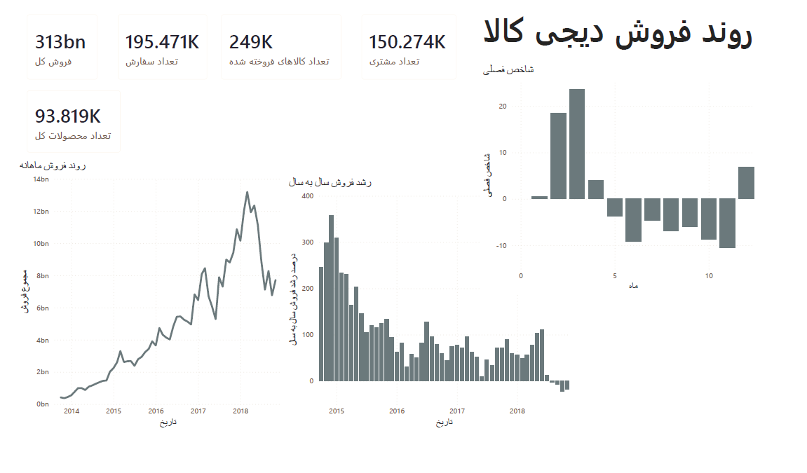
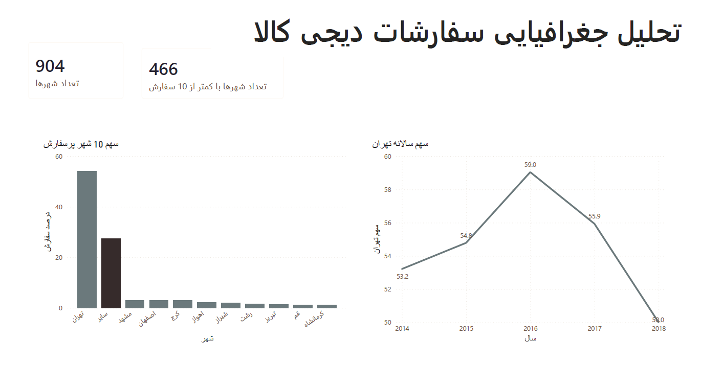
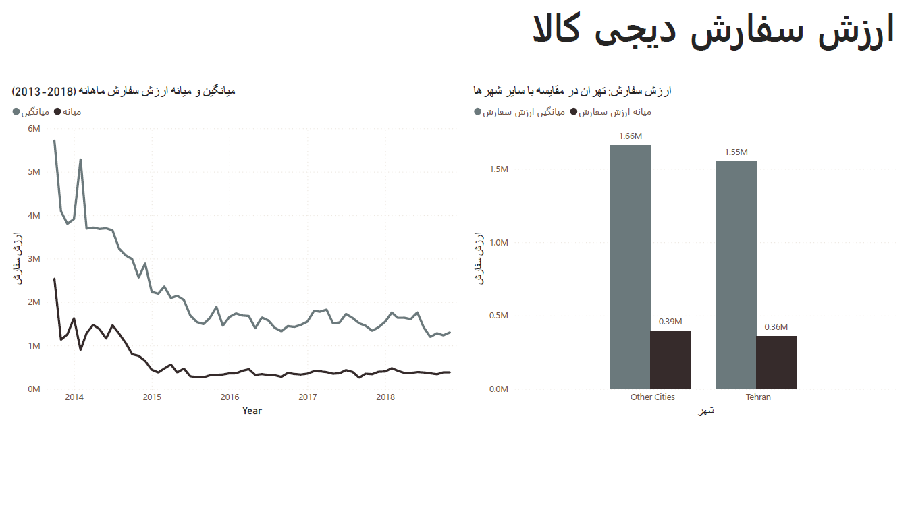
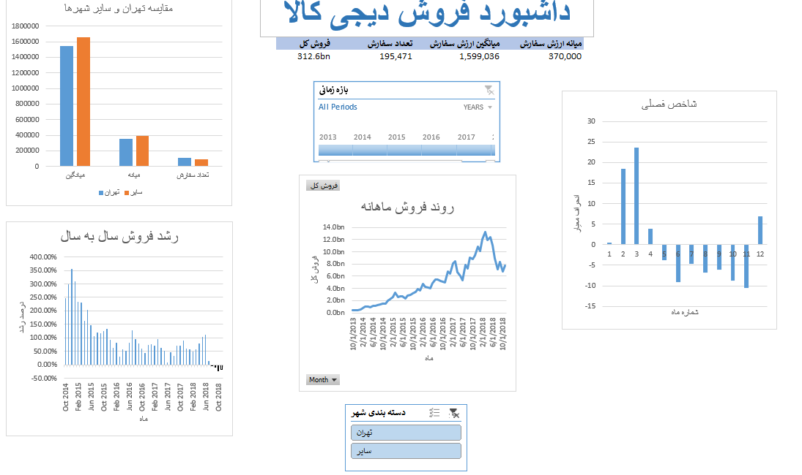

<div dir="rtl">

# تحلیل فروش دیجی‌کالا (۲۰۱۳ تا ۲۰۱۸)





**MySQL · Python (pandas) · Power BI · Excel**

- **منبع:** [دیتاست Digikala در Kaggle] https://www.kaggle.com/datasets/samansoltani/digikala/data

## بازتولید

دیتاست را از لینک بالا دانلود کن، در `data/` بگذار، اسم‌ها را بر اساس کدها تغییر بده و اسکریپت‌های `sql/` را به ترتیب ۰۱ تا ۰۵ اجرا کن.

[English](README.md)

تحلیل کامل روی نمونه‌ای از داده‌های سفارش دیجی‌کالا: ورود و پاک‌سازی داده در MySQL، پاسخ به سؤال‌های کسب‌وکاری با SQL، راستی‌آزمایی نتایج با pandas، ارائه‌ی آن‌ها در یک داشبورد سه‌صفحه‌ای Power BI و بازسازی نتایج اصلی در Excel.

## سؤال‌های کسب‌وکاری

1. روند فروش ماهانه چگونه بوده، رشد سال‌به‌سال چقدر است و آیا فصلی‌بودن وجود دارد؟
2. سفارش‌ها از نظر جغرافیایی چقدر متمرکزند (تهران در مقابل سایر شهرها)؟
3. ارزش یک سفارش معمولی چقدر است و ارزش سفارش در تهران و سایر شهرها چه تفاوتی دارد؟

## داده

- **منبع:** دیتاست «Digikala» در Kaggle (پنج جدول: `products`، `price`، `customers` (در واقع جدول اقلام سفارش)، `comments` و `comments_confirm`) که در اسکیمای `digikala_kaggle` در MySQL بارگذاری شد.
- **جدول استفاده‌شده:** فقط جدول سفارش‌ها؛ ۲۰۰٬۰۰۰ ردیف، ۱۹۷٬۶۳۱ سفارش، ۱۵۱٬۶۳۴ مشتری، ۹۰۶ شهر، از ۲۷ سپتامبر ۲۰۱۳ تا ۱۱ دسامبر ۲۰۱۸.
- **چرا فقط یک جدول:** اتصال سفارش‌ها به `products` فقط ۳٫۴۵٪ ردیف‌ها (و ۲٫۶٪ مبلغ) را پوشش می‌دهد، پس تحلیل دسته‌بندی ممکن نیست. جدول `price` هم فقط یک هفته را پوشش می‌دهد (۲۰۱۸-۱۱-۱۹ تا ۲۰۱۸-۱۱-۲۶).
- **واحد پول:** در دیتاست مستند نشده؛ بنابراین مبالغ با همان واحد خود دیتاست گزارش شده‌اند.

## پاک‌سازی و فیلترها

| مرحله        | تصمیم                                                                                                                                                                                                      |
| ------------ | ---------------------------------------------------------------------------------------------------------------------------------------------------------------------------------------------------------- |
| ماه‌های ناقص | **ماه‌های ناقص (سپتامبر ۲۰۱۳ و دسامبر ۲۰۱۸) از همه‌ی تحلیل‌های ماهانه کنار گذاشته شدند.** داده‌ی خام از ۲۷ سپتامبر ۲۰۱۳ تا ۱۱ دسامبر ۲۰۱۸ است و تحلیل‌ها بازه‌ی اکتبر ۲۰۱۳ تا نوامبر ۲۰۱۸ را پوشش می‌دهند. |
| تعریف فروش   | آزمایش نشان داد `Amount_Gross_Order` مثل قیمت واحد رفتار می‌کند (میانه‌ی نسبت برابر ۱٫۰)، پس **فروش = `Amount_Gross_Order` × `Quantity_item`**                                                             |
| تاریخ‌ها     | هنگام ورود به‌صورت متن ذخیره شدند و در پاک‌سازی تبدیل شدند                                                                                                                                                 |

جدول فیلترشده `orders_filtered` است و همه‌ی اعداد داشبورد روی آن محاسبه شده‌اند؛ برای همین جمع‌های داشبورد (۱۹۵٬۴۷۱ سفارش، ۱۵۰٬۲۷۴ مشتری، ۹۰۴ شهر) کمی کمتر از اعداد خام بالا هستند.

## نتایج مهم

### سؤال ۱ – روند فروش و فصلی‌بودن

- فروش ماهانه از ۲۰۱۴ رشد قوی داشت، در مارس ۲۰۱۸ به اوج رسید و بعد افت کرد.
- رشد سال‌به‌سال در سال‌های اول بسیار بالا بود و **از آگوست ۲۰۱۸ منفی می‌شود**.
- شاخص فصلی در **فوریه (۱٫۱۹) و مارس (۱٫۲۴)** بیشترین و در **نوامبر (۰٫۹۰)** کمترین مقدار است.
- روش: فروش هر ماه بر میانگین متحرک مرکزی ۲×۱۲ (روند) تقسیم می‌شود و نسبت‌ها برای هر ماه تقویمی میانگین‌گیری می‌شوند. فقط ماه‌هایی که پنجره‌ی کامل ۱۲‌ماهه دارند استفاده شده‌اند (آوریل ۲۰۱۴ تا مه ۲۰۱۸، ۵۰ مشاهده، ۴ یا ۵ مشاهده برای هر ماه تقویمی).

### سؤال ۲ – تمرکز جغرافیایی

- تهران حدود **۵۴٫۲٪** کل سفارش‌هاست؛ مشهد، اصفهان و کرج هرکدام حدود ۳٪.
- ۱۰ شهر برتر حدود **۷۲٫۵٪** سفارش‌ها را دارند.
- ۴۶۶ شهر کمتر از ۱۰ سفارش دارند (حدود ۰٫۷۸٪ سفارش‌ها): دُم بسیار بلند.
- سهم سالانه‌ی تهران: ۲۰۱۴: ۵۳٫۲٪ · ۲۰۱۵: ۵۴٫۸٪ · ۲۰۱۶: ۵۹٫۰٪ · ۲۰۱۷: ۵۵٫۹٪ · ۲۰۱۸: ۵۰٫۰٪

### سؤال ۳ – ارزش سفارش

- میانگین ارزش سفارش **۱٬۵۹۹٬۰۳۶** است (فروش کل ۳۱۲٫۶ میلیارد / ۱۹۵٬۴۷۱ سفارش)، اما میانه فقط **۳۷۰٬۰۰۰** است.
- ۱۰٪ گران‌ترین سفارش‌ها حدود **۶۶٫۱۲٪** کل فروش را ساخته‌اند.
- میانگین خیلی بالاتر از میانه است؛ یعنی توزیع ارزش سفارش‌ها چولگی مثبت دارد و میانه، سفارش معمولی را بهتر نشان می‌دهد.

**صدک‌های ارزش سفارش**

| p25     | p50 (میانه) | p75       | p90       | p99        | بیشینه        |
| ------- | ----------- | --------- | --------- | ---------- | ------------- |
| ۱۴۰٬۰۰۰ | ۳۷۰٬۰۰۰     | ۱٬۱۸۳٬۴۸۶ | ۳٬۲۹۰٬۰۰۰ | ۲۲٬۱۸۸٬۴۴۰ | ۱٬۵۳۰٬۰۰۰٬۰۰۰ |

**تهران در مقابل سایر شهرها**

| گروه       | میانگین   | میانه   | تعداد سفارش |
| ---------- | --------- | ------- | ----------- |
| تهران      | ۱٬۵۴۸٬۱۸۹ | ۳۵۷٬۷۹۸ | ۱۰۵٬۸۶۸     |
| سایر شهرها | ۱٬۶۵۹٬۱۱۳ | ۳۹۲٬۰۰۰ | ۸۹٬۶۰۳      |

## داشبورد (Power BI)

| صفحه                | محتوا                                                                                                                                       |
| ------------------- | ------------------------------------------------------------------------------------------------------------------------------------------- |
| ۱ – روند فروش       | کارت‌های شاخص (فروش کل ۳۱۳ میلیارد، ۱۹۵٬۴۷۱ سفارش، ۲۴۹ هزار کالای فروخته‌شده، ۱۵۰٬۲۷۴ مشتری)، نمودار فروش ماهانه، رشد سال‌به‌سال، شاخص فصلی |
| ۲ – تحلیل جغرافیایی | تعداد شهرها (۹۰۴)، شهرهای با کمتر از ۱۰ سفارش (۴۶۶)، سهم ۱۰ شهر برتر، سهم سالانه‌ی تهران                                                    |
| ۳ – ارزش سفارش      | میانگین و میانه‌ی ارزش سفارش ماهانه، تهران در مقابل سایر شهرها                                                                              |

## تحلیل در Excel

نتایج اصلی در Excel (`excel/digikala_analysis.xlsx`) از روی داده‌ی سفارش‌های خروجی MySQL دوباره ساخته شدند تا همان تحلیل با ابزاری دیگر نشان داده شود و نتایج SQL راستی‌آزمایی شوند.



| مرحله           | کار انجام‌شده                                                                                                                                                                   |
| --------------- | ------------------------------------------------------------------------------------------------------------------------------------------------------------------------------- |
| ورود و پاک‌سازی | Power Query: ورود داده‌ی سفارش‌ها، تنظیم نوع ستون‌ها، فیلتر اکتبر ۲۰۱۳ تا نوامبر ۲۰۱۸ و افزودن ستون‌های `Sales`، `Month` و `City_Group`                                         |
| جدول سفارش      | گروه‌بندی بر اساس `ID_Order` برای به‌دست‌آوردن ارزش هر سفارش (۱۹۵٬۴۷۱ سفارش)                                                                                                    |
| پیوت و نمودار   | PivotTable و PivotChart فروش ماهانه، با Slicer گروه شهر و Timeline تاریخ                                                                                                        |
| آمار            | `MEDIAN`، `PERCENTILE.INC`، `AVERAGEIFS`، `COUNTIFS` و `SUMIFS` برای صدک‌ها، سهم دهک بالا و مقایسه‌ی تهران با سایر شهرها؛ فرمول آرایه‌ای `MEDIAN(IF(...))` برای میانه‌ی هر گروه |
| رشد سال‌به‌سال  | `XLOOKUP` همراه با `EDATE` برای مقایسه‌ی هر ماه با همان ماه سال قبل                                                                                                             |
| شاخص فصلی       | همان روش SQL (نسبت به میانگین متحرک مرکزی ۲×۱۲) با فرمول                                                                                                                        |
| داشبورد         | کارت‌های شاخص، چهار نمودار، Slicer و Timeline در یک شیت (Slicer و Timeline فقط روی PivotChart فروش ماهانه اثر می‌گذارند)                                                        |

## اعتبارسنجی

تمامی سؤال‌ها هم با MySQL و هم با pandas محاسبه شدند و نتایج یکسان بود. اعداد اصلی (فروش کل، تعداد سفارش و میانه‌ی ارزش سفارش) در Excel هم بازتولید شدند.

## توصیه‌های کسب‌وکاری

این پیشنهادها فقط بر اساس همین نمونه‌ی داده‌اند و باید با داده‌ی کامل بررسی شوند.

- **کاهش وابستگی به تهران:** تهران حدود ۵۴٫۲٪ سفارش‌ها و ۱۰ شهر برتر حدود ۷۲٫۵٪ را دارند. سهم تهران از ۵۹٫۰٪ در ۲۰۱۶ به ۵۰٫۰٪ در ۲۰۱۸ رسیده و سفارش‌های سایر شهرها کمی ارزشمندترند (میانگین ۱٬۶۵۹٬۱۱۳ در برابر ۱٬۵۴۸٬۱۸۹). تمرکز بر رشد در مشهد، اصفهان و کرج (هرکدام حدود ۳٪) منطقی است.
- **بررسی افت فروش از آگوست ۲۰۱۸:** رشد سال‌به‌سال منفی شده است. پیش از هر تصمیمی باید علت روشن شود (قیمت، رقابت یا نمونه‌گیری داده).
- **برنامه‌ریزی فصلی:** فوریه و مارس بالاترین شاخص فصلی (۱٫۱۹ و ۱٫۲۴) و نوامبر پایین‌ترین (۰٫۹۰) را دارند. موجودی و کمپین‌ها را می‌توان با این الگو زمان‌بندی کرد؛ با احتیاط، چون هر ماه تقویمی فقط ۴ یا ۵ مشاهده دارد.
- **تمرکز بر مشتریان پرارزش:** ۱۰٪ گران‌ترین سفارش‌ها حدود ۶۶٫۱۲٪ فروش را می‌سازند، پس حفظ این مشتریان اثر بزرگی دارد.
- **گزارش با میانه:** میانگین سفارش (حدود ۱٫۶ میلیون) بیش از چهار برابر میانه (۳۷۰٬۰۰۰) است؛ برای نشان‌دادن سفارش معمولی میانه شاخص بهتری است.

## محدودیت‌ها

- دیتاست **نمونه‌ای** از تراکنش‌هاست، نه کل تاریخچه‌ی دیجی‌کالا.
- تحلیل دسته‌بندی (پوشش اتصال ۳٫۴۵٪) و تحلیل قیمت قابل‌اعتماد (فقط یک هفته داده) ممکن نیست.
- شاخص فصلی برای هر ماه تقویمی فقط ۴ یا ۵ مشاهده دارد؛ پس باید با احتیاط تفسیر شود.
- واحد پول مستند نشده است.

## ساختار مخزن

```
├── README.md
├── README.fa.md
├── sql/
│   ├── 01_import.sql
│   ├── 02_data_exploration.sql
│   ├── 03_cleaning.sql
│   ├── 04_data_quality_check.sql
│   └── 05_data_analysis.sql
├── notebooks/
│   ├── data_exploration.ipynb
│   └── data_analysis.ipynb
├── dashboard/
│   ├── digikala_dashboard.pbix
│   ├── digikala_dashboard.pdf
│   └── digikala_dashboard.png
├── excel/
│   └── digikala_analysis.xlsx
├── data/processed/        # small summary tables used by the dashboard
└── images/
```

## منبع داده

داده: داده‌ی باز دیجی‌کالا (نسخه‌ی Kaggle). شرایط داده‌ی باز دیجی‌کالا ذکر منبع را الزامی و استفاده‌ی تجاری بدون اجازه‌ی کتبی را ممنوع کرده است در نتیجه این مخزن داده‌ی خام ندارد.

</div>
