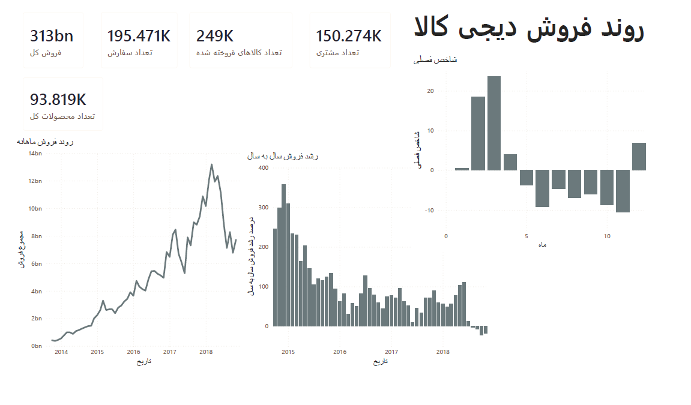
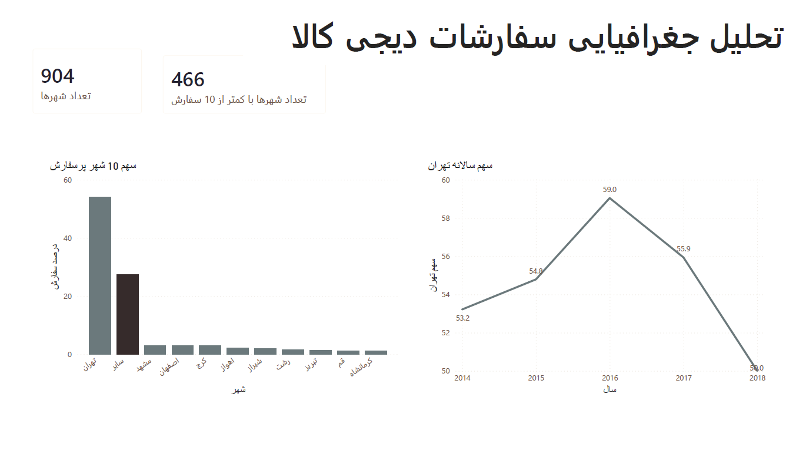
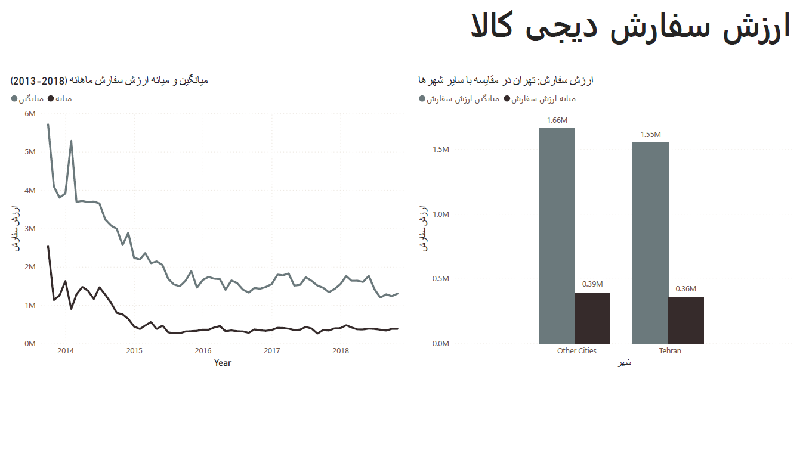
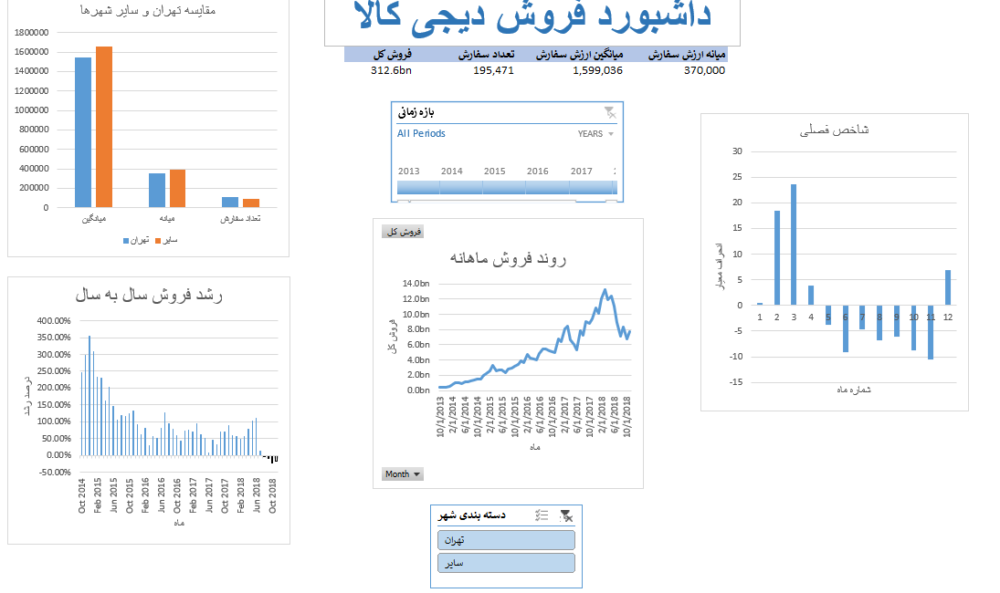

# Digikala Sales Analysis (2013–2018)





**MySQL · Python (pandas) · Power BI · Excel**

- **Source:** [Digikala dataset on Kaggle] https://www.kaggle.com/datasets/samansoltani/digikala/data

## Reproduce

Download the dataset from the link above, place it in `data/`, rename the tables according to the code and run the scripts in `sql/` in order (01 to 05).

[فارسی](README.fa.md)

An end-to-end analysis of a sample of Digikala order data: importing and cleaning in MySQL, answering business questions in SQL, cross-checking the results in pandas, presenting them in a 3-page Power BI dashboard, and rebuilding the main results in Excel.

## Business questions

1. How have monthly sales changed over time, what is the year-over-year growth, and is there seasonality?
2. How concentrated are orders geographically (Tehran vs. other cities)?
3. How large is a typical order, and how does order value differ between Tehran and other cities?

## Data

- **Source:** Kaggle "Digikala" dataset (5 tables: `products`, `price`, `customers` (actually the order-lines table), `comments` and `comments_confirm`), loaded into the MySQL schema `digikala_kaggle`.
- **Table used:** only the orders table: 200,000 rows, 197,631 orders, 151,634 customers, 906 cities, from 27 Sep 2013 to 11 Dec 2018.
- **Why only one table:** joining orders to `products` matches only 3.45% of rows (2.6% of amount), so category analysis is not possible. The `price` table covers a single week (2018-11-19 to 2018-11-26).
- **Currency:** not documented in the dataset, so amounts are reported in the dataset's own units.

## Cleaning and filters

| Step              | Decision                                                                                                                                                                                  |
| ----------------- | ----------------------------------------------------------------------------------------------------------------------------------------------------------------------------------------- |
| Incomplete months | **The incomplete months (Sep 2013 and Dec 2018) were excluded from all monthly analyses.** The raw data runs from 27 Sep 2013 to 11 Dec 2018, and the analyses cover Oct 2013 – Nov 2018. |
| Sales definition  | A test showed `Amount_Gross_Order` behaves like a unit price (median ratio = 1.0), so **sales = `Amount_Gross_Order` × `Quantity_item`**                                                  |
| Dates             | Stored as text on import; converted during cleaning                                                                                                                                       |

The filtered table is `orders_filtered`; every dashboard number is computed on it, which is why the dashboard totals (195,471 orders, 150,274 customers, 904 cities) are slightly lower than the raw counts above.

## Key results

### Q1 – Sales trend and seasonality

- Monthly sales grew strongly from 2014, peaked in March 2018, then dropped.
- Year-over-year growth was very high in the early years and **turns negative from Aug 2018**.
- The seasonal index is highest in **Feb (1.19) and Mar (1.24)** and lowest in **Nov (0.90)**.
- Method: each month's sales are divided by a centered 2×12 moving average (the trend), and the ratios are averaged per calendar month. Only months with a full 12-month window are used (Apr 2014 – May 2018, 50 observations, 4–5 per calendar month).

### Q2 – Geographic concentration

- Tehran is about **54.2%** of all orders; Mashhad, Isfahan and Karaj are about 3% each.
- The top 10 cities account for about **72.5%** of orders.
- 466 cities have fewer than 10 orders each (about 0.78% of orders): a very long tail.
- Tehran's yearly share of orders: 2014: 53.2% · 2015: 54.8% · 2016: 59.0% · 2017: 55.9% · 2018: 50.0%

### Q3 – Order value

- Average order value is **1,599,036** (total sales 312.6bn / 195,471 orders), but the median is only **370,000**.
- The most expensive 10% of orders make up about **66.12%** of total sales.
- The mean is far above the median, so order values are right-skewed and the median describes a typical order better than the mean.

**Order value percentiles**

| p25     | p50 (median) | p75       | p90       | p99        | Max           |
| ------- | ------------ | --------- | --------- | ---------- | ------------- |
| 140,000 | 370,000      | 1,183,486 | 3,290,000 | 22,188,440 | 1,530,000,000 |

**Tehran vs. other cities**

| Group        | Mean      | Median  | Orders  |
| ------------ | --------- | ------- | ------- |
| Tehran       | 1,548,189 | 357,798 | 105,868 |
| Other cities | 1,659,113 | 392,000 | 89,603  |

## Dashboard (Power BI)

| Page                    | Contents                                                                                                                                     |
| ----------------------- | -------------------------------------------------------------------------------------------------------------------------------------------- |
| 1 – Sales trend         | KPI cards (total sales 313bn, 195,471 orders, 249K items sold, 150,274 customers), monthly sales line, year-over-year growth, seasonal index |
| 2 – Geographic analysis | Number of cities (904), cities with <10 orders (466), top-10 cities' share of orders, Tehran's yearly share                                  |
| 3 – Order value         | Monthly mean vs. median order value, Tehran vs. other cities                                                                                 |

## Excel analysis

The main results were rebuilt in Excel (`excel/digikala_analysis.xlsx`) from the order data exported from MySQL, to show the same analysis with a different toolset and to cross-check the SQL results.



| Step                  | What was done                                                                                                                                                                          |
| --------------------- | -------------------------------------------------------------------------------------------------------------------------------------------------------------------------------------- |
| Import and clean      | Power Query: imported the order data, set data types, filtered Oct 2013 – Nov 2018, added `Sales`, `Month` and `City_Group` columns                                                    |
| Order table           | Grouped by `ID_Order` to get the value of each order (195,471 orders)                                                                                                                  |
| Pivot and charts      | PivotTable and PivotChart for monthly sales, with a city-group slicer and a date timeline                                                                                              |
| Statistics            | `MEDIAN`, `PERCENTILE.INC`, `AVERAGEIFS`, `COUNTIFS` and `SUMIFS` for percentiles, top-decile share and Tehran vs. other cities; the array formula `MEDIAN(IF(...))` for group medians |
| Year-over-year growth | `XLOOKUP` with `EDATE` to compare each month with the same month a year earlier                                                                                                        |
| Seasonal index        | Same method as in SQL (ratio to centered 2×12 moving average), built with formulas                                                                                                     |
| Dashboard             | KPI cards, four charts, a slicer and a timeline on one sheet (the slicer and timeline filter only the monthly sales PivotChart)                                                        |

## Validation

All questions were computed in both MySQL and pandas, and the results matched. The headline figures (total sales, number of orders, median order value) were reproduced in Excel as well.

## Business recommendations

These suggestions are based on this sample only and should be verified on the full data.

- **Reduce dependence on Tehran:** Tehran accounts for about 54.2% of orders and the top 10 cities for about 72.5%. Tehran's share fell from 59.0% in 2016 to 50.0% in 2018, and orders from other cities are slightly more valuable (mean 1,659,113 vs. 1,548,189). Focusing growth on Mashhad, Isfahan and Karaj (about 3% each) is a reasonable next step.
- **Investigate the sales decline since Aug 2018:** Year-over-year growth turned negative. The cause (pricing, competition or data sampling) should be established before acting.
- **Plan around seasonality:** Feb and Mar have the highest seasonal index (1.19 and 1.24) and Nov the lowest (0.90). Inventory and campaigns can be timed accordingly, with caution because each calendar month has only 4–5 observations.
- **Focus on high-value customers:** The most expensive 10% of orders make up about 66.12% of sales, so retaining these customers has a large impact.
- **Report the median:** The mean order value (about 1.6M) is more than four times the median (370,000), so the median is a better KPI for a typical order.

## Limitations

- The dataset is a **sample** of transactions, not the full Digikala history.
- No category analysis (3.45% join coverage) and no reliable price analysis (one week of data).
- The seasonal index has only 4–5 observations per calendar month, so it should be interpreted with caution.
- Currency is undocumented.

## Repository structure

```
├── README.md
├── README.fa.md
├── sql/
│   ├── 01_import.sql
│   ├── 02_data_exploration.sql
│   ├── 03_cleaning.sql
│   ├── 04_data_quality_check.sql
│   └── 05_data_analysis.sql
├── notebooks/
│   ├── data_exploration.ipynb
│   └── data_analysis.ipynb
├── dashboard/
│   ├── digikala_dashboard.pbix
│   └── digikala_dashboard.pdf
├── excel/
│   └── digikala_analysis.xlsx
├── data/processed/        # small summary tables used by the dashboard
└── images/
```

## Data attribution

Data: Digikala open data (Kaggle mirror). Digikala's open-data terms require attribution and forbid commercial use without written permission. This repository does not contain the raw data.
